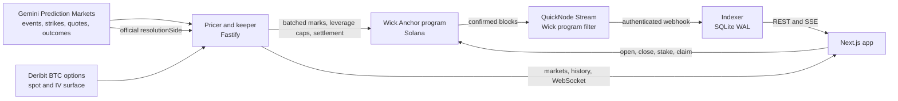

# Wick

**The leverage and liquidity layer for prediction markets. Trade any Gemini market at up to 300x, priced from Deribit options and filled by a self-funding pool on Solana.**

A prediction contract is a digital option. Wick prices every Gemini strike from Deribit's BTC options surface, caps leverage by how fast each market can move, and fills every trade from a pool that funds itself from trading. Every position settles on Gemini's official outcome, never on a price Wick invents.

[Live app](https://wick-markets-phi.vercel.app/) · [Program on Solana Explorer](https://explorer.solana.com/address/GY2WTMTTpSh3xBaf1HYGP5PDic5vjA5wucJdTci92GL8?cluster=devnet) · [CI](https://github.com/alycz/wick/actions/workflows/ci.yml) · [Pricing audit](docs/nov18-btc-strike-pricing-audit.html)

UBC Hackathon 2026 · Track 02, DeFi & Onchain Apps · Built on Gemini Prediction Markets, Solana, QuickNode Streams and Deribit.

## What makes Wick different

1. **Fair value on every strike.** Gemini's order books are deepest near the likely result and thin in the tails. Wick quotes every strike, tails included, at an options-implied fair price. [`packages/pricing/src/theo.ts`](packages/pricing/src/theo.ts)
2. **Leverage sized to each market's risk.** One fixed leverage limit is too tight for a month-out strike and reckless for a contract with minutes left. Wick computes a cap per market from binary gamma: about 4x with 10 minutes left, 38x at 12 hours and 300x on a month-out strike. The program enforces it on every trade. [`packages/pricing/src/risk.ts`](packages/pricing/src/risk.ts)
3. **A pool that is always the counterparty.** Wick's pool takes the other side of every trade, so traders get filled even when Gemini's book is empty. There are no LP deposits: losing trades and liquidations grow the pool, and every losing dollar mints up to 100 $WICKED. [`programs/wick/src/lib.rs`](programs/wick/src/lib.rs)

## Verify it in 60 seconds

```bash
# The program is live and executable on Solana devnet
curl -s https://api.devnet.solana.com -H 'content-type: application/json' \
  -d '{"jsonrpc":"2.0","id":1,"method":"getAccountInfo","params":["GY2WTMTTpSh3xBaf1HYGP5PDic5vjA5wucJdTci92GL8",{"encoding":"base64"}]}' \
  | grep -o '"executable":true'

# 191 TypeScript tests across pricing, Gemini parsing, the backend, the app and scripts (about 11 seconds)
pnpm install --frozen-lockfile && pnpm test

# 16 native Rust tests for the program's fixed-point math
cargo test -p wick
```

CI runs lint, every TypeScript suite, `anchor build` and nine Anchor lifecycle tests on a local validator for every push. The lifecycle suite in [`tests/anchor/wick.anchor.test.ts`](tests/anchor/wick.anchor.test.ts) covers:

- profit and loss closes on YES and NO;
- liquidation exactly at the stored boundary, and rejection one tick above it;
- stale-mark, cutoff and leverage-cap rejections;
- per-position and per-market exposure caps;
- settlement from one official outcome;
- the FIFO payout queue;
- void refunds;
- fees, $WICKED emissions and staking rewards.

It also runs 1,000 deterministic pricing vectors inside the deployed Rust program and matches them against the TypeScript engine.

## How it works



One backend process runs market discovery, pricing, the keeper, liquidator and settler loops, the Streams webhook, the indexer and the read APIs ([`services/backend/src/main.ts`](services/backend/src/main.ts)). Solana is the source of truth. If the index is lost, positions and markets rebuild from program accounts. See [Architecture](docs/ARCHITECTURE.md) for component boundaries and recovery.

## Pricing

All probabilities are clamped to `[0.01, 0.99]`. `S` is BTC spot, `K` the strike, `σ` annualized volatility and `T` time to expiry in years.

**Up/Down contracts** are digital options:

```text
d2    = (ln(S/K) - σ²T/2) / (σ√T)
p_yes = N(d2)
```

The strike is Gemini's captured reference strike, and ATM volatility is interpolated to Gemini's expiry. Gemini settles some markets on a short time-weighted window, so the final minute uses an adjusted variance:

```text
effective variance = σ²·max(T - 60s, 0) + σ²·min(T, 60s)/3
```

**"BTC above K" ladder contracts** use a symmetric Black-76 call spread, which captures the volatility smile directly:

```text
h     = 0.25% · K
p_yes = [C(K - h, σ(K - h)) - C(K + h, σ(K + h))] / (2h)
```

Per-expiry IV is a cubic spline in log-moneyness `ln(K/F)` with flat wings. Between expiries Wick interpolates total variance `w = σ²T`, because Deribit's expiries never line up with Gemini's. The model is checked against real expired Gemini strikes in the [November 18 pricing audit](docs/nov18-btc-strike-pricing-audit.html). Code: [`theo.ts`](packages/pricing/src/theo.ts), [`smile.ts`](packages/pricing/src/smile.ts).

## Risk-based leverage

```text
g     = φ(d2) / (σ√T)              binary mark sensitivity
σ_m   = g · σ · √Δt                Δt = 5 seconds
L_cap = floor(p_side · (1 - mm) / (3 · σ_m))
```

The cap is sized so a three-sigma five-second move stays inside margin. The keeper posts it with every mark, and `open_position` rejects any trade above the market's cap or the global ceiling.

| Market | Time left | Leverage cap (σ = 0.5, ATM) |
|---|---|---|
| 15-minute contract | 10 minutes | 4x |
| Daily contract | 12 hours | 38x |
| Month-out contract | 30 days | 300x |

These vectors are asserted in [`packages/pricing/tests/risk.test.ts`](packages/pricing/tests/risk.test.ts).

## Economic design and risk assumptions

Wick's pool is the counterparty to every position. It is protocol-seeded and grows from trading losses, liquidations and fees, with no LP deposits to withdraw in a drawdown. Four on-chain controls bound its risk:

- **Leverage cap per market.** Each market's cap comes from the formula above and is enforced on every open.
- **Liability caps.** Per-position payout caps and per-market and vault exposure caps bound the worst-case payout before a trade is accepted.
- **Winners are always paid first.** Margin returns immediately. Profit beyond free liquidity becomes a FIFO `PayoutClaim`, which is senior to every staker distribution.
- **$WICKED emissions decay.** $WICKED is minted only against realised losses: 100 tokens per $1 below the emission threshold, then `100·(C/(C+H))²` as the high-water mark `H` grows.

Fees on profit and on liquidation are 200 bps each, split 50/50 between $WICKED stakers and the treasury. Stakers also earn pool surplus above the staker cap once the payout queue is empty.

Wick's assumptions are explicit:

- Deribit's surface reflects BTC volatility. If it goes stale, marks stop and the program halts new trades.
- An authorised keeper posts marks, bounded on-chain by signer, staleness, slippage, cutoff and leverage checks.
- Gemini's published `resolutionSide` is final. An `invalid` event is voided and margin refunded.

## How Wick uses Solana

All economic state lives in one Anchor program with 18 instructions, 6 account types and 20 events ([`programs/wick/src`](programs/wick/src)).

- **Accounts.** Markets, positions, the vault, payout claims and stakes are PDAs.
- **Enforcement.** The program enforces margin, the leverage cap, stale-mark and cutoff checks, liquidation, settlement, exposure limits, the payout queue, $WICKED emissions and staking. It does so with 53 `require!` checks and checked u128/i128 fixed-point math.
- **Events.** Every mutating instruction emits an Anchor event for the indexer.
- **Why Solana.** The keeper posts batched marks for every live Gemini market every few seconds. That cadence and cost is only practical on Solana.

| Account | Address |
|---|---|
| Wick program | [`GY2WTMTTpSh3xBaf1HYGP5PDic5vjA5wucJdTci92GL8`](https://explorer.solana.com/address/GY2WTMTTpSh3xBaf1HYGP5PDic5vjA5wucJdTci92GL8?cluster=devnet) |
| $WICKED mint (authority is the pool PDA) | [`G7Za5zgi7GaHKButBTZsjyCfWh9LnmQqGtQbUTe6nQwP`](https://explorer.solana.com/address/G7Za5zgi7GaHKButBTZsjyCfWh9LnmQqGtQbUTe6nQwP?cluster=devnet) |
| Test USDC mint (mint and freeze authority revoked) | [`HLb5ovT6hS5TP5CYhTqZgoHnPh93bCzU5tthZcYWmAgU`](https://explorer.solana.com/address/HLb5ovT6hS5TP5CYhTqZgoHnPh93bCzU5tthZcYWmAgU?cluster=devnet) |
| Config PDA | [`CYXmfcdiTW2jsx949ZxnbHQSfcudTW5TzsWurFYQ7oHc`](https://explorer.solana.com/address/CYXmfcdiTW2jsx949ZxnbHQSfcudTW5TzsWurFYQ7oHc?cluster=devnet) |
| Pool (LP) PDA | [`B2ffn9mwu3ihewWK7b6fWZ8StCfuPwYFJE1eh6cYLzeu`](https://explorer.solana.com/address/B2ffn9mwu3ihewWK7b6fWZ8StCfuPwYFJE1eh6cYLzeu?cluster=devnet) |
| Vault | [`HX9HvC3rZG3FbVQYLVDs1E5bukcVB2oR1uvyMoXpGUVE`](https://explorer.solana.com/address/HX9HvC3rZG3FbVQYLVDs1E5bukcVB2oR1uvyMoXpGUVE?cluster=devnet) |
| Staking vault | [`GVvvXsUGY5N2AFJeCSeecTpzYNn3piwiySdy4Lvgvof4`](https://explorer.solana.com/address/GVvvXsUGY5N2AFJeCSeecTpzYNn3piwiySdy4Lvgvof4?cluster=devnet) |
| Keeper | [`J4Y9nHEihf7h13DH2R8d3Aezk9qtKXS1iBnyokfRC1kJ`](https://explorer.solana.com/address/J4Y9nHEihf7h13DH2R8d3Aezk9qtKXS1iBnyokfRC1kJ?cluster=devnet) |
| SPL Token, Associated Token and System programs | `TokenkegQfeZyiNwAJbNbGKPFXCWuBvf9Ss623VQ5DA`, `ATokenGPvbdGVxr1b2hvZbsiqW5xWH25efTNsLJA8knL`, `11111111111111111111111111111111` |

## Gemini Prediction Markets integration

Gemini is Wick's market list and its only outcome oracle. Wick runs on every Gemini market it lists. BTC is live today, from 5-minute Up/Down to month-end strikes, and each new market category plugs into the same pricing and risk engine.

| Endpoint or channel | What Wick uses it for |
|---|---|
| `GET /v1/prediction-markets/events?status=active` | Discover and classify every active contract; REST quote fallback |
| `GET /v1/prediction-markets/events/{eventTicker}` | Authoritative status, `resolutionSide` and settlement value |
| `GET /v1/prediction-markets/events/{eventTicker}/strike` | Capture reference strikes as each Up/Down window opens |
| `wss://ws.gemini.com` `{symbol}@bookTicker` | Live bid, ask and last trade |
| `wss://ws.gemini.com` `contractStatus` | React to contract lifecycle changes as they happen |
| `GET /v1/pubticker/btcusd` | Secondary spot check |

Quotes stream over WebSocket with a two-second REST fallback. Every response passes a strict schema ([`packages/gemini/src/schemas.ts`](packages/gemini/src/schemas.ts)) tested against recorded real responses: 23 events, 72 contracts and 20 settled events in [`packages/gemini/fixtures`](packages/gemini/fixtures). Positions settle only on Gemini's `resolutionSide` ([`services/backend/src/pricer/engine.ts`](services/backend/src/pricer/engine.ts)). API observations are in [Findings](docs/FINDINGS.md).

## QuickNode Streams

QuickNode Streams pushes every confirmed Wick transaction from Solana to the backend, so positions, activity, the leaderboard and pool history update within seconds without polling.

- **Network:** `solana-devnet`.
- **Dataset:** `block`, from the chain tip.
- **Filter:** [`streams/filter.js`](streams/filter.js) matches the Wick program ID in top-level and inner instructions, skips failed transactions, and returns signature, slot, block time and program logs.
- **Destination:** an authenticated HTTPS webhook on the backend at `/streams/webhook`. It uses a constant-time secret check and a durable inbox ([`services/backend/src/indexer/routes.ts`](services/backend/src/indexer/routes.ts)).
- **Consumers:** Anchor events are decoded and upserted idempotently into SQLite WAL ([`services/backend/src/indexer`](services/backend/src/indexer)). They feed `/feed`, `/positions`, `/leaderboard`, `/lp/history` and the SSE stream.
- **Why Streams:** confirmed activity reaches the interface with low latency, and a 60-second RPC reconciler only fills gaps.

The Stream is created idempotently by [`scripts/create-stream.ts`](scripts/create-stream.ts), which tests the filter against a real program transaction before activating it.

## Deribit

Deribit supplies the BTC index and the full options chain over REST and WebSocket ([`packages/vol/src/deribit.ts`](packages/vol/src/deribit.ts)). Wick fits each expiry's smile and interpolates between expiries to price any Gemini strike at any time to expiry.

## Repository map

```text
programs/wick/       Anchor program and checked fixed-point math
packages/pricing/    fair value, smile interpolation, leverage and position math
packages/gemini/     Gemini REST and WebSocket clients with real response fixtures
packages/vol/        Deribit volatility surface
packages/shared/     contracts, schemas, constants and the program IDL
services/backend/    pricer, keeper, Streams indexer, SQLite and Fastify APIs
app/                 Next.js trading, portfolio, pool, stats and leaderboard
streams/filter.js    QuickNode Solana block filter
scripts/             deployment, Stream creation and verification
docs/                architecture, Gemini findings and the pricing audit
```

## Run it

Pinned toolchain: Node.js `>=22 <25`, pnpm `11.25.0`, Rust `1.85.1`, Solana CLI `2.2.20`, Anchor `0.31.1`.

```bash
corepack enable
corepack prepare pnpm@11.25.0 --activate
pnpm install --frozen-lockfile
cp .env.example .env
pnpm lint
pnpm test
pnpm build
cargo test -p wick
```

Run the backend and app locally:

```bash
# terminal 1
SQLITE_PATH=.state/wick.db pnpm --filter @wick/backend dev

# terminal 2
NEXT_PUBLIC_BACKEND_URL=http://localhost:3000 pnpm --filter @wick/app dev
```

The program ID, test USDC mint and devnet RPC are defaults in [`packages/shared/src/constants.ts`](packages/shared/src/constants.ts). The keeper needs `PROGRAM_ID`, `USDC_TEST_MINT` and `KEEPER_KEYPAIR` to post marks. Never commit `.env` or keypairs.

## What's next

- **Testnet:** public testnet for all traders, a multi-party keeper network, and invariant and fuzz testing.
- **Mainnet:** an independent audit and live USDC trading on Solana.
- **Every Gemini market:** crypto beyond BTC, then sports, weather and commodities on the same engine.

Team: Austin Lee and James Gui.
