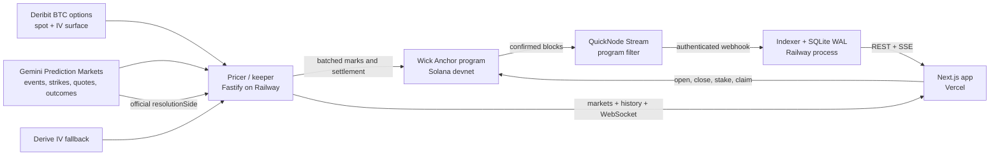

# Wick

**Every Gemini strike, at fair value. Risk-capped leverage up to 300x.**

Wick is a Solana devnet application for leveraged synthetic YES/NO positions on Gemini's live BTC prediction markets. It computes an options-implied fair value for every supported strike, shows that value beside Gemini's bid and ask, and sizes leverage market by market using binary gamma. Trades settle against Gemini's official outcome, never a price invented by Wick.

> **Verification status — November 17, 2026:** the application, Anchor program, pricing engine, indexer, frontend, deployment gates, and recording pipeline are implemented and pass local checks. Public Gemini and volatility feeds were exercised successfully. Wick is **not deployed**: there is no executable devnet Wick program, test-USDC mint, Railway service, Vercel URL, active QuickNode Stream, or demo video. The ID currently present in the source is a build-time identity only. See [HANDOFF](docs/HANDOFF.md), [DEPLOYMENT](docs/DEPLOYMENT.md), and [ELIGIBILITY](docs/ELIGIBILITY.md). No sponsor or working-demo eligibility is claimed before those gates pass.

Wick is a UBC Hackathon 2026 project for Track 02, DeFi & Onchain Apps. It is devnet-only software using test assets; it is not audited and is not a real-money product.

## The problem

Prediction-market order books are usually deepest near the most likely result. Tail strikes can be thin, one-sided, or absent precisely where a trader wants a view. A single static leverage limit compounds that problem: leverage safe for a month-end tail can be reckless for an at-the-money contract with minutes left.

Wick separates price discovery from book depth. It turns the BTC option volatility surface into a theoretical YES probability for each Gemini contract, then applies a market-specific risk cap. The result is a transparent reference price for the whole strike ladder and leverage that falls when binary risk becomes sharp.

## What Wick does

- Discovers live Gemini BTC 5-minute, 15-minute, hourly, daily, weekly, and month-end prediction contracts.
- Streams Gemini quotes and contract status, with a two-second REST fallback.
- Builds a BTC volatility surface from Deribit, falling back to Derive and then realized volatility.
- Prices Up/Down and “above” ladder contracts, and displays theo beside Gemini's book.
- Computes a binary-gamma leverage cap for every market.
- Implements margin, liquidation, settlement, liability limits, queued payouts, $WICKED emissions, and staking in an Anchor program.
- Uses a self-bootstrapping pool: trading losses add liquidity rather than requiring an outside LP deposit.
- Indexes Anchor events into SQLite and exposes positions, activity, leaderboard, and pool history.
- Provides a responsive Next.js interface with a devnet demo wallet and Phantom/Solflare options.

Wick does **not** claim to be the first leveraged prediction market. Its differentiation is the combination of:

1. every Gemini strike, tails included, quoted at an options-implied fair price instead of relying only on a thin order book;
2. a pool that bootstraps itself from trader losses, so no outside LP capital is required; and
3. a binary-gamma risk engine that sets leverage per market, allowing high leverage where it is safer and reducing it where it is not.

## Architecture

The diagram shows the intended deployed topology. The current public deployment is pending.



The backend is one process: market discovery, pricing, keeper/liquidator/settler loops, Streams webhook, SQLite writer, read API, WebSocket, and SSE. Solana remains the source of truth. If SQLite is lost, current markets and positions rebuild with `getProgramAccounts`; a labelled 60-second `getSignaturesForAddress` job reconciles gaps but is not the primary event path.

See [Architecture](docs/ARCHITECTURE.md) for component boundaries, trust assumptions, storage, and recovery.

## Pricing

All probabilities are clamped to `[0.01, 0.99]`. Let `S` be BTC spot, `K` the strike, `σ` annualized volatility, and `T` time to expiry in 365-day years.

### Up/Down contracts

```text
d2    = (ln(S/K) - σ²T/2) / (σ√T)
p_yes = N(d2)
```

The strike is Gemini's captured reference strike. ATM volatility is interpolated to the Gemini expiry. Because Gemini can settle against a short time-weighted window, the default one-minute adjustment uses:

```text
effective variance = σ²·max(T - 60s, 0) + σ²·min(T, 60s)/3
```

### Ladder contracts

For Gemini's strict “BTC above K” contracts, Wick uses a symmetric Black-76 call spread:

```text
h     = 0.25% · K
p_yes = [C(K - h, σ(K - h)) - C(K + h, σ(K + h))] / (2h)
```

This captures smile skew without a separate correction. Per-expiry IV is a cubic spline in log-moneyness `ln(K/F)` with flat wing extrapolation. Between expiries Wick linearly interpolates total variance `w = σ²T`; before the first option expiry it keeps volatility flat.

### Risk-based leverage

```text
g     = φ(d2) / (σ√T)                         binary mark sensitivity
σ_m   = g · σ · √Δt                           Δt = 5 seconds
L_cap = clamp(floor(p_side·(1-mm)/(3·σ_m)), 1, global_max)
```

The production safety factor is `k = 3`; `mm` is the maintenance margin fraction. These deterministic reference vectors use `σ = 0.5`, ATM `p = 0.5`, and the global cap above each result:

| Market horizon | Time remaining | Calculated maximum leverage |
|---|---:|---:|
| 15-minute contract | 10 minutes | 4x |
| Daily contract | 12 hours | 38x |
| Long-dated contract | 30 days | 300x |

An experimental `k = 1` vector produces `902x` at 30 days, but Wick's configured formula uses `k = 3`. The live cap also changes with probability, volatility, time, and the global limit; “up to 300x” is positioning, not a guaranteed cap on every trade.

## Position and pool economics

Wick uses six-decimal fixed-point USDC and contracts. Prices use micro-units where `1_000_000 = $1.00`.

```text
side_mark = YES ? mark_yes : 1_000_000 - mark_yes
contracts = margin · leverage · 1_000_000 / entry
pnl(m)    = contracts · (m - entry) / 1_000_000
liq_mark  = entry · [1 - (1-mm)/leverage]
```

- The trader's margin transfers to the program vault when a position opens.
- Losing PnL grows the pool. A liquidation contributes the margin to the pool.
- The default profitable-PnL fee and liquidation fee are each 200 bps. Fees split 50/50 between the staking accumulator and treasury.
- Profits pay from free vault balance. If liquidity is short, margin pays first and the remainder enters a FIFO `PayoutClaim` queue. Later pool gains repay queued claims before surplus distribution.
- Each market and the whole vault enforce payout/exposure caps; the configured liability allowance permits initial trades while the pool is young.
- Losses mint six-decimal `$WICKED`. Below the emission threshold the target is 100 tokens per $1 loss; above it emissions decay as `100·(C/(C+H))²`, using emission constant `C` and high-water mark `H`.
- `$WICKED` stakers earn their fee share and eligible surplus above the staker cap, but surplus distributes only when the payout queue is empty.
- There are no user-provided LP deposits. This is a deliberate experimental, self-bootstrapping design—not a solvency guarantee.

### Risk and trust assumptions

- **Trusted keeper:** an authorized keeper creates markets, posts marks, and submits Gemini's official settlement. On-chain signer checks, staleness checks, slippage bounds, cutoffs, leverage caps, and liability caps constrain it, but a production system would need decentralized oracle/keeper governance.
- **Outcome oracle:** Gemini's `resolutionSide` is authoritative. Wick does not infer outcomes from Deribit, spot, or its own theo. An `invalid` Gemini event is voided.
- **Price/volatility oracle:** Deribit is primary for index and IV; Derive and then realized volatility are fallbacks. If all are unhealthy or data is stale, marks stop and the on-chain stale-mark check halts new trading.
- **Pool solvency:** profitable claims can queue. Exposure limits reduce insolvency risk but cannot promise instant payout or eliminate model/oracle/keeper risk.
- **Smart-contract risk:** checked integer math and tests reduce implementation risk; they do not replace an audit.
- **Environment:** devnet, self-minted test USDC, no real funds, no mainnet support.

## How Solana is used

The Anchor program owns the economic state and enforces the core rules: market creation and marks, opening/closing positions, liquidation, official-outcome settlement and voids, payout queue processing, $WICKED emissions, and staking. Accounts are PDAs for config, vault, LP state, markets, positions, claims, and stakes. Every mutating instruction emits an Anchor event for the indexer.

### Program address registry

| Program | Address | Status / explorer |
|---|---|---|
| Wick custom Anchor program | **Pending deployment** | No explorer link is valid yet. Source currently contains build-time identity `EBfYyDsDq4rEL9hqi7CwbM3rW1zYvBAfdRcWLdbWeMxi`; it is not executable on devnet and must not be presented as deployed. |
| SPL Token Program | `TokenkegQfeZyiNwAJbNbGKPFXCWuBvf9Ss623VQ5DA` | [Devnet explorer](https://explorer.solana.com/address/TokenkegQfeZyiNwAJbNbGKPFXCWuBvf9Ss623VQ5DA?cluster=devnet) |
| Associated Token Account Program | `ATokenGPvbdGVxr1b2hvZbsiqW5xWH25efTNsLJA8knL` | [Devnet explorer](https://explorer.solana.com/address/ATokenGPvbdGVxr1b2hvZbsiqW5xWH25efTNsLJA8knL?cluster=devnet) |
| System Program | `11111111111111111111111111111111` | [Devnet explorer](https://explorer.solana.com/address/11111111111111111111111111111111?cluster=devnet) |

After verified deployment, replace the pending row with the actual program ID and `https://explorer.solana.com/address/<PROGRAM_ID>?cluster=devnet`. The test-USDC and `$WICKED` mint addresses are also pending and will be recorded in [HANDOFF](docs/HANDOFF.md).

## QuickNode Streams

The implemented configuration is:

- **Network:** `solana-devnet`
- **Dataset:** `block`, beginning at the chain tip
- **Filter:** `streams/filter.js` substitutes the deployed Wick program ID, examines top-level and inner instructions, skips failed transactions, and retains the signature, slot, block time, and program logs
- **Destination:** an authenticated public HTTPS `/streams/webhook` on the Railway backend; the secret is sent in a redacted header
- **Storage/consumers:** Anchor events are decoded and idempotently upserted into SQLite WAL, powering the activity feed, positions, leaderboard, and LP chart through REST/SSE
- **Why Streams:** confirmed Wick activity is pushed to the interface at low latency without making polling the primary path

### Evidence gate

The filter, webhook, SQLite projections, and guarded REST creation script exist, but **there is no live Stream**. Wick will claim the QuickNode Streams bounty only after all of these are evidenced:

- an active Stream ID and terminal active status on Solana devnet/block;
- a real deployed-program transaction matched by QuickNode's filter-test endpoint and saved as the fixture;
- a public authenticated destination receiving that delivery; and
- the same real transaction appearing in `/feed` in roughly two seconds.

Until then QuickNode must not be selected on the Devpost bounty form. See [Eligibility](docs/ELIGIBILITY.md).

## Gemini Prediction Markets integration

Wick uses public Gemini market data, not Gemini order placement:

| Endpoint/channel | Purpose |
|---|---|
| `GET /v1/prediction-markets/events?status=active&search=BTC&limit=500&offset=0` | Discover and classify active BTC contracts; provide REST quote fallback |
| `GET /v1/prediction-markets/events/{eventTicker}` | Read authoritative status, `resolutionSide`, and settlement value |
| `GET /v1/prediction-markets/events/{eventTicker}/strike` | Watch reference strikes until an Up/Down window opens |
| `wss://ws.gemini.com` `{symbol}@bookTicker` | Stream live public bid, ask, and last trade |
| `wss://ws.gemini.com` `contractStatus` | React to public contract lifecycle changes |
| `GET /v1/pubticker/btcusd` | Secondary BTC spot check |

The strict parsers and real API observations are documented in [Findings](docs/FINDINGS.md). Market settlement always uses Gemini's official per-contract outcome.

## Repository map

```text
programs/wick/       Anchor program and checked fixed-point math
packages/pricing/    theo, smile interpolation, leverage and position math
packages/gemini/     public REST/WebSocket clients and real response fixtures
packages/vol/        Deribit, Derive, and realized-volatility sources
packages/shared/     contracts, schemas, constants, generated-IDL placeholder
services/backend/    pricer, chain port, Streams indexer, SQLite, Fastify APIs
app/                 Next.js trading, portfolio, pool, wallet, faucet UI
streams/filter.js    QuickNode Solana block filter
scripts/             deployment, bots, verification, and recording gates
docs/                architecture, findings, deployment, demo, and submission
```

## Setup

### Prerequisites

- Node.js `>=22 <25`
- pnpm `11.25.0`
- Rust `1.85.1`
- Solana/Agave CLI `2.2.20`
- Anchor CLI `0.31.1`
- SPL Token CLI for mint/deployment work

Versions are pinned in `package.json`, `rust-toolchain.toml`, `Anchor.toml`, and Cargo manifests.

### Install and validate

```bash
corepack enable
corepack prepare pnpm@11.25.0 --activate
pnpm install --frozen-lockfile
cp .env.example .env
pnpm lint
pnpm test
pnpm build
cargo test -p wick
```

Never commit `.env`, keypairs, provider tokens, or generated deployment keys.

### Run the read-only local surfaces

The current backend deliberately uses `UnconfiguredChainPort`, so it can serve real public market data locally but cannot acknowledge an on-chain trade.

```bash
# terminal 1
SQLITE_PATH=.state/wick.db pnpm --filter @wick/backend dev

# terminal 2
NEXT_PUBLIC_BACKEND_URL=http://localhost:3000 pnpm --filter @wick/app dev
```

Open the URL printed by the app. Real Gemini/volatility data needs outbound network access. Chain actions and the faucet fail closed until a deployed program, generated IDL, mint, and funded devnet authorities are configured.

### Deploy and verify the full devnet system

Follow [Deployment](docs/DEPLOYMENT.md) in order. The non-negotiable gates are:

```bash
pnpm deploy:check --require-ready
pnpm deploy:program
pnpm sync:idl
pnpm create:mint
pnpm init:config
# deploy Railway and Vercel with provider-secret stores
pnpm create:stream -- --test-only
pnpm create:stream
pnpm deploy:verify
```

Do not infer success from a command submission or provider URL. `deploy:verify` requires an executable program, six-decimal mint, chain-enabled healthy backend, live 15-minute market, recent Stream-backed feed event, and reachable frontend.

## Verification and tests

The repository has strict TypeScript, Vitest suites for pricing, provider parsing/fallbacks, backend/indexer, frontend and scripts, plus native Rust tests. CI also defines Anchor build/test with pinned tooling. Real public API fixtures are kept for Gemini; no fake market data ships in the app.

Current live verification is limited to public, read-only data: Gemini discovery/quotes and settlement parsing, Deribit, Derive, and a read-only backend pricing run. On-chain lifecycle, Stream latency, faucet, bots, public browser flow, and demo recording remain pending deployment.

## Known limitations

- No public deployment, executable devnet Wick program, generated deployed IDL, test mint, Stream, or video exists yet.
- The backend chain adapter is explicitly unconfigured, so keeper writes, liquidations, and settlements cannot run end to end.
- The public Solana devnet faucet returned HTTP 410 in this environment; the documented treasury, keeper, and demo-wallet funder have zero SOL.
- QuickNode, Railway, Vercel, and authenticated GitHub credentials/project contexts are absent.
- The self-bootstrapping pool can queue profitable payouts and depends on future losses/liquidity; it is experimental economics.
- Keeper/oracle trust is not decentralized, the contracts are unaudited, and provider/API availability can interrupt service.
- Wick supports BTC Up/Down and above-strike ladders only; it does not place Gemini orders, support touch/High-Low contracts, accept external LP deposits, or run on mainnet.

## Submission status

The copy-ready answers are in [Devpost](docs/DEVPOST.md), the 2:45 verified-product storyboard is in [Demo](docs/DEMO.md), and outstanding evidence is in [Handoff](docs/HANDOFF.md). Internal deployment/verification cutoff: **Thursday, November 19, 2026 at 11:59 PM CST**. Official submission close: **Friday, November 20, 2026 at 12:00 PM CST**. Finalists must be present in person in Austin on Saturday, November 21 to qualify for prizes under the official rules.

Official references are linked from [Eligibility](docs/ELIGIBILITY.md).
