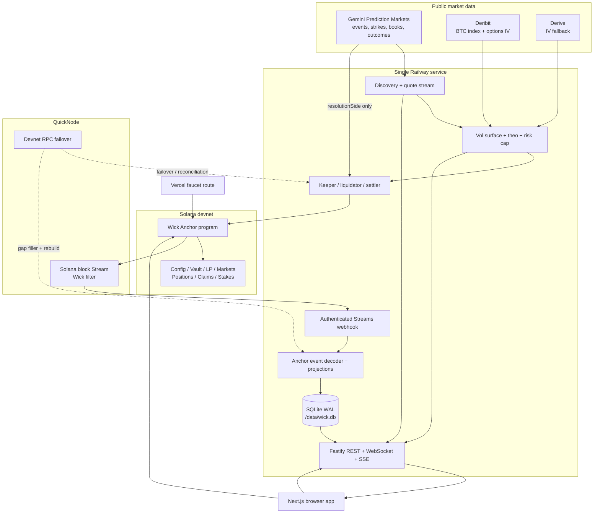

# Wick architecture

This document describes the implemented design and the intended devnet deployment. It is not deployment evidence. As of November 17, 2026, Wick has no executable devnet program or public provider deployment; the backend's chain port is deliberately unconfigured.

## System context



The service stays deliberately compact: one Node process and one SQLite writer reduce coordination and hosting cost. SQLite is a projection; Solana is authoritative.

## Component responsibilities

| Component | Responsibility | Source |
|---|---|---|
| Anchor program | Enforce fixed-point position math, signer permissions, fresh marks, cutoffs, leverage/liability limits, liquidations, settlement, queue, emissions and staking | `programs/wick/` |
| Pricing library | Pure Up/Down and ladder theo, volatility interpolation, binary-gamma leverage caps and liquidation distance | `packages/pricing/` |
| Gemini client | Strict public REST/WS parsing, BTC market classification, quotes, strikes and official outcomes | `packages/gemini/` |
| Volatility sources | Deribit BTC index and options surface for live pricing | `packages/vol/` |
| Pricer engine | Discover contracts, calculate theo/caps each second, batch marks, liquidate and settle | `services/backend/src/pricer/` |
| Streams indexer | Authenticate deliveries, decode Anchor events, idempotently project state, rebuild/reconcile gaps | `services/backend/src/indexer/` |
| Web application | Markets, trade preview/actions, portfolio, pool, live activity and devnet wallet/faucet UX | `app/` |
| Operations scripts | Readiness, deploy, initialize, mint, bots, Stream creation, public verification and demo recording | `scripts/` |

## Market-data and pricing flow

1. Every ten seconds, discovery reads active Gemini BTC events and selects current/next short windows and all open strikes across the dated BTC ladders.
2. Gemini `bookTicker` updates quotes in real time. A rejected or unavailable socket falls back to the active-events endpoint every two seconds.
3. Deribit supplies the BTC index and options IV surface for every live mark. Data older than five seconds is unhealthy.
4. The pricing package interpolates smile and total variance, calculates YES theo, clamps it to 1–99¢, and derives a five-second binary-gamma leverage cap.
5. The pricer computes every second. A deployed keeper would submit a batched mark only after a 0.1¢ move, cap change, or four-second heartbeat.
6. If volatility is unhealthy, it stops marks. The program's stale-mark check then rejects new positions.

Gemini is the sole outcome authority. After expiry, the settler polls until Gemini returns `settled` or `invalid`, submits `resolutionSide` and the official settlement value, and then cranks positions and payout claims.

## On-chain model

The program uses six-decimal test USDC and integer arithmetic with checked wide intermediates. Its main PDAs are:

- `Config`: admin, keeper, mint and risk/economic parameters;
- `Vault`: token account controlled by the vault PDA;
- `LpState`: pool balance, watermark, fees, queue, rewards, supply and mint;
- `Market`: Gemini symbol hash, strike/window, mark, risk cap, exposure and outcome;
- `Position`: owner, market, side, margin, leverage, entry, contracts and liquidation mark;
- `PayoutClaim`: FIFO amount and paid balance; and
- `StakeAccount`: $WICKED amount and reward debt.

Authority is intentionally narrow: the keeper can create markets, post marks and settle/void, while traders sign their own position/staking actions and anyone can liquidate, settle eligible positions or crank the queue. The program validates keeper authority, clock windows, staleness, slippage, caps and status transitions.

## Event and read path

```mermaid
sequenceDiagram
  participant P as Wick program
  participant Q as QuickNode Stream
  participant W as /streams/webhook
  participant D as SQLite WAL
  participant A as App SSE/REST

  P->>Q: confirmed devnet block + Anchor logs
  Q->>Q: match top-level/inner Wick instruction; skip failed tx
  Q->>W: signature, slot, blockTime, logs
  W-->>Q: HTTP 200 after auth/schema validation
  W->>D: decode + transactionally upsert(signature,event_index)
  D-->>A: feed, positions, leaderboard, LP snapshots
```

The destination secret travels in `x-wick-stream-secret`, is redacted from logs, and is compared in constant time. The webhook validates the envelope and defers synchronous SQLite work until after acknowledgement. Events use the generated Anchor IDL when available and exact program layouts as a build-time fallback.

SQLite runs in WAL mode with migrations at boot and one writer. Duplicate Stream deliveries do not duplicate projections. On an empty database, the indexer reconstructs markets and positions with `getProgramAccounts`. Every 60 seconds a labelled, non-primary gap filler checks recent program signatures and applies missing event logs oldest first.

## Frontend and transaction boundary

The frontend treats backend responses and chain configuration as untrusted input and validates them. Read surfaces use REST, a market WebSocket and activity SSE. Transaction actions build real Solana instructions only when program ID, generated IDL, wallet, RPC and mint state are configured; otherwise the UI fails closed with a readable message.

The browser-only practice account is a separate local-storage path. New accounts start with no fabricated history, use unmistakable `demo-receipt-*` identifiers, do not accrue synthetic rewards, and leave expiry pending rather than deriving an outcome from BTC spot. Existing version-1 records are migrated rather than discarded: their local balances and records are preserved, chain-shaped identifiers are replaced, every migrated record is labelled simulated/unverified, and the untouched v1 JSON remains in a local backup key. Previously accrued synthetic rewards are retained only as disclosed migration metadata, never as an active or claimable balance. Practice balance changes and receipts are not network transfers, explorer signatures, pool-solvency evidence, or QuickNode Stream evidence.

The “Try it now” devnet flow creates a local browser keypair and calls a server-only faucet route. The faucet is devnet-only and transfers 0.05 devnet SOL plus 1,000 test USDC from one treasury in one confirmed transaction. Provisioning creates exactly 200 grants of supply in advance and permanently revokes both mint and freeze authorities; every request re-verifies the exact supply, revoked authorities, treasury ATA ownership and available balance. Concurrent serverless functions therefore cannot exceed the finite on-chain inventory. The browser/IP ten-minute cooldown is explicitly best-effort per warm instance, not a distributed identity boundary. Provider key material never enters client bundles.

## Consistency and failure behavior

| Failure | Behavior |
|---|---|
| Gemini WebSocket unavailable | Logged switch to two-second public REST polling |
| Deribit unhealthy/stale | New marks pause until Deribit recovers |
| Keeper mark stale | Program rejects new opens |
| Stream duplicate | Unique `(signature,event_index)` makes ingestion idempotent |
| Stream gap/pause | 60-second public-RPC reconciliation backfills recent signatures |
| SQLite loss | Current markets/positions rebuild from program accounts |
| Vault cannot pay full profit | Margin pays first; remainder enters FIFO claim queue |
| Provider credential absent | Readiness/deployment command exits non-zero; no fake success |
| Chain adapter unconfigured | Backend health exposes `chainConfigured: false`; writes reject |

## Trust and security boundaries

- The program trusts the configured keeper to relay marks and Gemini outcomes, subject to program checks.
- Gemini is trusted for contract definitions and final outcome; Deribit supplies market data for theo.
- QuickNode is transport, not state authority. Every event corresponds to Solana logs and reconciliation can recover gaps.
- Railway owns backend secrets and the persistent volume; Vercel owns faucet secrets. Logs redact authorization, webhook and key fields.
- Public RPC is primary for regular reads/writes to protect QuickNode credits; QuickNode RPC is failover.
- Devnet keys and tokens are operational secrets, even though assets have no monetary value.

This design is unaudited. It mitigates but does not eliminate oracle, keeper, smart-contract, provider, liquidity, model or operational risk.

## Deployment and evidence state

| Surface | Implemented | Verified public |
|---|:---:|:---:|
| Public Gemini and vol reads | Yes | Yes, read-only checks documented in `FINDINGS.md` |
| Anchor program logic | Yes | No executable devnet deployment |
| Backend pricer/indexer | Yes | No Railway service; chain port unconfigured |
| Frontend | Yes | No Vercel production URL |
| QuickNode filter/webhook | Yes | No Stream, real filter fixture or latency evidence |
| Demo recorder | Yes | No truthful deployed-app MP4 |

The ordered path from pending to verified is [DEPLOYMENT.md](DEPLOYMENT.md). Sponsor and submission evidence gates are [ELIGIBILITY.md](ELIGIBILITY.md).
